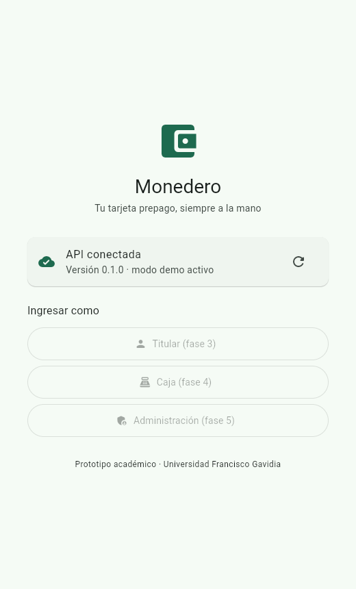
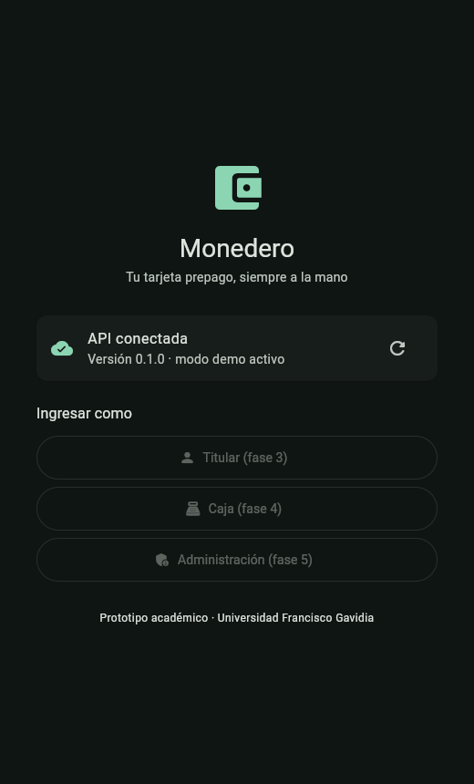

# Monedero

**Monedero electrónico prepago recargable de circuito cerrado**: como la tarjeta prepago de un supermercado. Cada tarjeta tiene un número único y un saldo que se recarga en caja y se gasta en compras dentro del comercio.

Prototipo de demostración del proyecto de **Gestión de la Calidad del Software**, Facultad de Ingeniería y Sistemas, **Universidad Francisco Gavidia (UFG)**. Aunque es académico, se diseña y documenta como un sistema real que maneja dinero de clientes.

> "Monedero" es un nombre provisional. Ver [NAMING.md](NAMING.md).

<p align="center">
  
  
</p>
<p align="center"><em>Fase 1: pantalla inicial (web) conectada a la API local, en tema claro y oscuro. Las capturas de la demo completa se agregan en la Fase 6.</em></p>

| Componente | Tecnología |
|---|---|
| App (Android + Web) | Flutter, Riverpod, go_router, Material 3 |
| API | Dart, `shelf` + `shelf_router` |
| Base de datos | PostgreSQL 17 |
| Código compartido | `packages/core` (pub workspaces) |
| Entorno local | Docker Compose: PostgreSQL, API y Mailpit |
| Producción (solo preparada) | VPS Contabo, Caddy, pgBackRest → Backblaze B2 |

## Inicio rápido

Requisitos: Git, Flutter, Docker Desktop y Chrome ([guía de instalación](docs/setup.md)).

```bash
git clone <url-del-repositorio> monedero && cd monedero
flutter pub get
dart run tool/up.dart
cd apps/app
flutter run -d chrome --web-port 5000
```

- API: <http://localhost:8080/health>
- Correos de verificación (Mailpit): <http://localhost:8025>
- Detener todo: `dart run tool/down.dart`
- Verificar antes de un commit: `dart run tool/check.dart`

En Android: emulador con `flutter run`; teléfono, ver [setup.md § 5](docs/setup.md#5-conectar-android-a-la-api-local).

## Credenciales de demostración

Se crean con los datos de demostración en la **Fase 2** (`dart run tool/seed.dart`). Se listarán aquí y en [docs/demo.md](docs/demo.md).

## Estado

**Fase 1 de 6** — esqueleto, entorno y documentación. Ver [docs/ROADMAP.md](docs/ROADMAP.md).

## Documentación

| Documento | Contenido |
|---|---|
| [AGENTS.md](AGENTS.md) | Instrucciones para cualquier IA y persona: comandos, invariantes, convenciones |
| [docs/setup.md](docs/setup.md) | Instalación en Windows (incluido LTSC) y macOS |
| [docs/architecture.md](docs/architecture.md) | Componentes y flujo de una operación |
| [docs/domain.md](docs/domain.md) | Reglas de negocio, estados y glosario |
| [docs/api.md](docs/api.md) · [openapi.yaml](docs/openapi.yaml) | Endpoints, errores y ejemplos |
| [docs/database.md](docs/database.md) | Modelo de datos, migraciones y permisos |
| [docs/testing.md](docs/testing.md) | Pruebas y qué demuestran |
| [docs/demo.md](docs/demo.md) | Guion de demostración de 10 minutos |
| [docs/nfc.md](docs/nfc.md) | Plan para tarjetas físicas MIFARE Classic |
| [docs/deploy-contabo.md](docs/deploy-contabo.md) | Producción (solo preparada) |
| [docs/adr/](docs/adr/) | Decisiones técnicas |
| [CONTRIBUTING.md](CONTRIBUTING.md) | Ramas, commits y revisión |

## Equipo

- Kevin Alexander González Calderón
- Cesar Rodrigo Cerón Cruz
- David Alexis Navarrete Gálvez
- Leonardo *(apellidos por completar)*
- Bayron *(apellidos por completar)*
- Steven *(apellidos por completar)*
