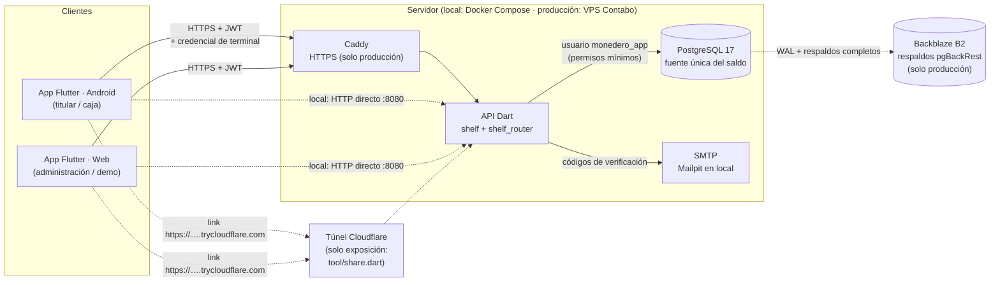
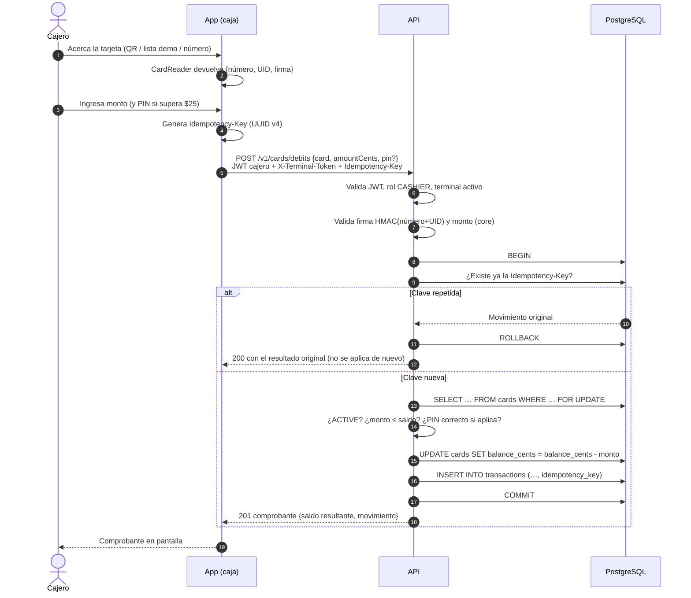

# Arquitectura

## 1. Vista general



| Componente | Tecnología | Responsabilidad |
|---|---|---|
| App | Flutter (Android + Web), Riverpod, go_router, Material 3 | Interfaz de los tres roles; lee tarjetas (`CardReader`); **nunca** decide el saldo |
| `packages/core` | Dart puro | Errores, DTOs, Luhn, validación de montos y firma de tarjeta, compartidos por app y API |
| API | Dart, `shelf` + `shelf_router`, paquete `postgres` | Autenticación, autorización por rol, reglas de negocio, transacciones e idempotencia; sirve también el build web de la app en `/` |
| Base de datos | PostgreSQL 17 | Saldo y movimientos; restricciones `CHECK`, triggers de solo inserción, vista de conciliación |
| Correo | SMTP (Mailpit en local) | Códigos de verificación y avisos de cada movimiento |
| Túnel | `cloudflare/cloudflared` (perfil `compartir`) | Link público temporal para la exposición ([ADR 0011](adr/0011-exposicion-por-link-con-tunel-y-web-en-la-api.md)) |
| Caddy | Solo producción | TLS automático y proxy inverso |
| pgBackRest → Backblaze B2 | Solo producción | Respaldo continuo y restauración a un punto en el tiempo |

## 2. Principios

1. **La base de datos es la fuente de verdad.** La app solo muestra; la API decide; PostgreSQL impone las últimas reglas (`CHECK`, triggers, permisos).
2. **Defensa en profundidad.** Cada regla de dinero se valida en la app (experiencia de usuario), en la API (autoridad) y en la base (última barrera).
3. **Sin operación sin conexión.** Toda operación que cambia saldo requiere la API.
4. **Hardware intercambiable.** La app depende de la interfaz `CardReader`; hoy `SimulatedCardReader` (QR, lista demo, número manual), mañana `NfcMifareCardReader` sin tocar la lógica.

## 3. Flujo de una operación: cobro en caja



Si dos cajas cobran a la misma tarjeta al mismo tiempo, `FOR UPDATE` serializa las operaciones; si aun así un error dejara el saldo negativo, `CHECK (balance_cents >= 0)` aborta la transacción. Si la red falla después del `COMMIT`, la app reintenta con la **misma** `Idempotency-Key` y recibe el resultado original.

## 4. La app por dentro

```
apps/app/lib/
  brand/brand.dart        nombre, color semilla y logotipo (único lugar)
  card_reader/            CardReader, SimulatedCardReader, NfcMifareCardReader (Fase 7)
  core/
    api/                  ApiClient: JSON, errores por ApiErrorCode, Idempotency-Key
    config/               URL del servidor (predeterminada o elegida en "Servidor")
    session/              Session y SessionNotifier: una sesión por rol, renovación
    storage.dart          shared_preferences (localStorage en la web)
    theme/                temas Material 3 claro/oscuro y AppPalette
    widgets/              tarjeta virtual, ticket, QR, avisos y distribución
  features/
    home/                 inicio: roles, estado del servidor, QR para el celular
    auth/                 inicio de sesión común (cuentas demo en modo demo)
    holder/               titular: tarjeta, QR, pago con código, PIN, pérdida, registro
    cashier/              caja: vínculo del terminal, lectura, cobro, recarga, actividad
    admin/                administración: tablero, tarjetas, titulares, cajas
    settings/             servidor (pegar o escanear el link)
```

- **Una sesión por rol.** `holderSessionProvider`, `cashierSessionProvider` y `adminSessionProvider` se guardan por separado; en un mismo navegador pueden convivir las tres pestañas de la demo. `SessionNotifier.run` agrega el JWT y, si venció, lo renueva una vez con el token de renovación ([ADR 0010](adr/0010-renovacion-de-sesion-y-limite-de-solicitudes.md)).
- **Caja vinculada al dispositivo.** La credencial del terminal se guarda en el dispositivo, aparte de la sesión del cajero (varios cajeros por turno en la misma caja).
- **Sin operación sin conexión.** Solo se guarda el último saldo del titular para mostrarlo "no actualizado"; las credenciales de la tarjeta no se guardan.
- **Idempotencia desde la interfaz.** La clave se genera al confirmar una operación y se reutiliza si hay que reintentar por un error de red; con respuesta del servidor (aprobada o rechazada) la siguiente operación lleva clave nueva.

### Interfaz

- Material 3 claro y oscuro derivados de `Brand.seedColor`; sin fuentes externas.
- El dinero y los códigos son los protagonistas: cifras tabulares (`AppText.money`) y pesos fuertes.
- Elementos propios del comercio: la tarjeta virtual con chip y proporción de tarjeta física (colores fijos de la marca en ambos temas), el ticket dentado del comprobante y el código de caja en grande.
- Jerarquía de esquinas: 24 en la tarjeta, 16 en contenedores, 12 en campos y botones.
- Una columna en celular y dos desde 900 px; administración usa riel lateral en escritorio y barra inferior en celular.
- El gráfico del tablero sigue el método del skill de visualización: un eje, columnas de 24 px como máximo, leyenda, detalle al pasar el mouse o tocar y vista de tabla; colores validados para daltonismo en ambos temas (`AppPalette`).

## 5. Despliegue

| Entorno | Cómo | Estado |
|---|---|---|
| Local / demo | `docker-compose.yml`: PostgreSQL, Mailpit, API (que sirve la web). `dart run tool/up.dart`. | Activo |
| Exposición por link | `dart run tool/share.dart`: lo anterior más el túnel de Cloudflare ([exposicion.md](exposicion.md)) | Activo (solo mientras dura la exposición) |
| Producción | `deploy/docker-compose.prod.yml` en un VPS de Contabo: Caddy, API, PostgreSQL y pgBackRest → Backblaze B2 | Solo preparado (Fase 6), **no se ejecuta** |

Más detalle: [database.md](database.md), [api.md](api.md), [deploy-contabo.md](deploy-contabo.md), [ADR](adr/).
