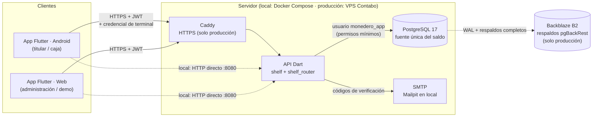
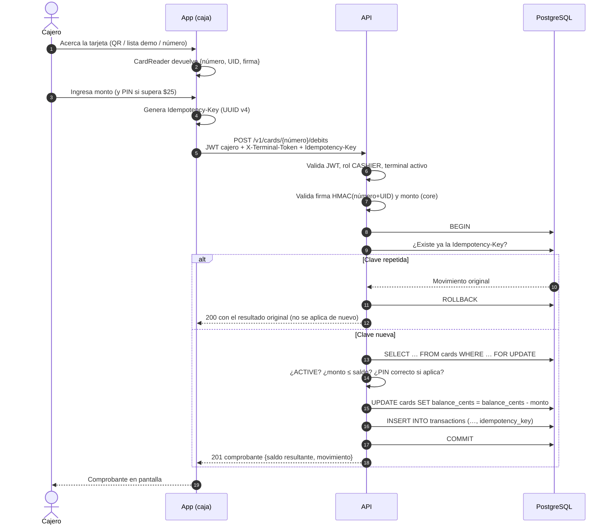

# Arquitectura

## 1. Vista general

| Componente | Tecnología | Responsabilidad |
|---|---|---|
| App | Flutter (Android + Web), Riverpod, go_router, Material 3 | Interfaz de los tres roles; lee tarjetas (`CardReader`); **nunca** decide el saldo |
| `packages/core` | Dart puro | Errores, DTOs, Luhn, validación de montos y firma de tarjeta, compartidos por app y API |
| API | Dart, `shelf` + `shelf_router`, paquete `postgres` | Autenticación, autorización por rol, reglas de negocio, transacciones e idempotencia |
| Base de datos | PostgreSQL 17 | Saldo y movimientos; restricciones `CHECK`, triggers de solo inserción, vista de conciliación |
| Correo | SMTP (Mailpit en local) | Códigos de verificación para registro y reporte de pérdida |
| Caddy | Solo producción | TLS automático y proxy inverso |
| pgBackRest → Backblaze B2 | Solo producción | Respaldo continuo y restauración a un punto en el tiempo |

## 2. Principios

1. **La base de datos es la fuente de verdad.** La app solo muestra; la API decide; PostgreSQL impone las últimas reglas (`CHECK`, triggers, permisos).
2. **Defensa en profundidad.** Cada regla de dinero se valida en la app (experiencia de usuario), en la API (autoridad) y en la base (última barrera).
3. **Sin operación sin conexión.** Toda operación que cambia saldo requiere la API.
4. **Hardware intercambiable.** La app depende de la interfaz `CardReader`; hoy `SimulatedCardReader` (QR, lista demo, número manual), mañana `NfcMifareCardReader` sin tocar la lógica.

## 3. Flujo de una operación: cobro en caja

Si dos cajas cobran a la misma tarjeta al mismo tiempo, `FOR UPDATE` serializa las operaciones; si aun así un error dejara el saldo negativo, `CHECK (balance_cents >= 0)` aborta la transacción. Si la red falla después del `COMMIT`, la app reintenta con la **misma** `Idempotency-Key` y recibe el resultado original.

## 4. Despliegue

| Entorno | Cómo | Estado |
|---|---|---|
| Local / demo | `docker-compose.yml`: PostgreSQL, Mailpit, API. App con `flutter run`. | Activo |
| Producción | `deploy/docker-compose.prod.yml` en un VPS de Contabo: Caddy, API, PostgreSQL y pgBackRest → Backblaze B2 | Solo preparado (Fase 6), **no se ejecuta** |

Más detalle: [database.md](database.md), [api.md](api.md), [deploy-contabo.md](deploy-contabo.md), [ADR](adr/).
