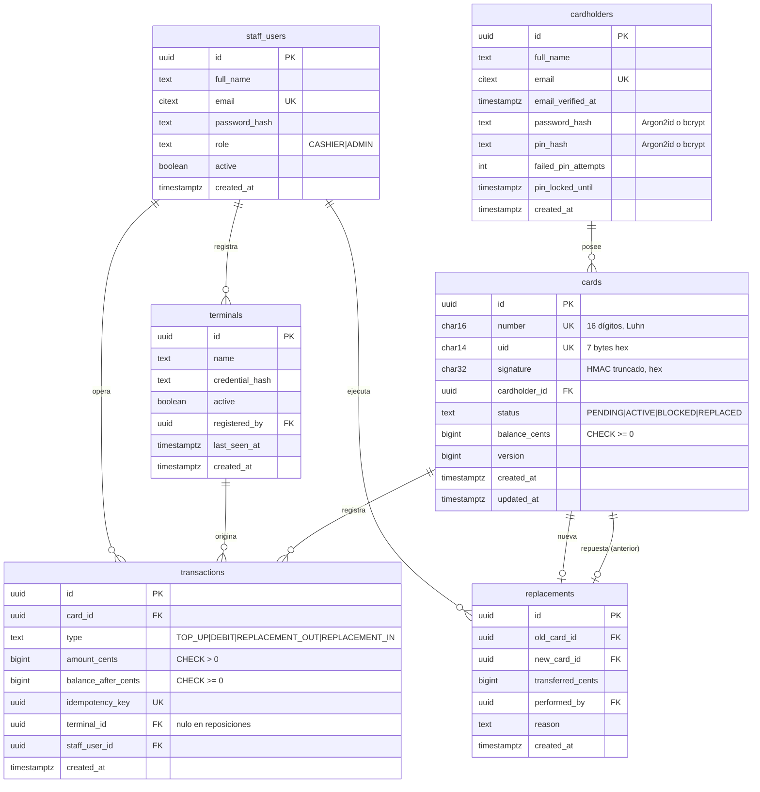

# Base de datos

PostgreSQL **17** (`postgres:17.11` en Docker). Es la **única fuente de verdad del saldo**.

> Estado: **implementado** en `db/migrations/0001_initial_schema.sql` (Fase 2). Las pruebas de `api/test/integration/` verifican estas barreras contra PostgreSQL real.

## 1. Modelo entidad-relación (diseño)

Tabla auxiliar: `verification_codes` (hash SHA-256 del código, propósito `VERIFY_EMAIL` o `REPORT_LOSS`, vencimiento de 10 minutos e intentos). La idempotencia vive en `transactions.idempotency_key` y `replacements.idempotency_key`, ambas `UNIQUE`; la reposición usa claves derivadas `<clave>:out` y `<clave>:in` para sus dos movimientos.

## 2. Barreras en la base

| Barrera | Implementación |
|---|---|
| Saldo nunca negativo | `CHECK (balance_cents >= 0)` en `cards` |
| Montos positivos | `CHECK (amount_cents > 0)` en `transactions` |
| Idempotencia | `UNIQUE (idempotency_key)` en `transactions` |
| Movimientos inalterables | Sin `UPDATE`/`DELETE` para `monedero_app` **y** trigger `BEFORE UPDATE OR DELETE` que lanza excepción |
| Estados válidos | `CHECK (status IN ('PENDING','ACTIVE','BLOCKED','REPLACED'))` |
| Conciliación | Vista `card_reconciliation`: `balance_cents` frente a `SUM(±amount_cents)` por tarjeta y su diferencia |

## 3. Roles y permisos

| Rol de PostgreSQL | Uso | Permisos |
|---|---|---|
| `monedero_owner` | Dueño del esquema; solo migraciones | Todo sobre el esquema `monedero` |
| `monedero_app` | Conexión de la API (lo crea `tool/migrate.dart` con `POSTGRES_APP_PASSWORD`) | `SELECT, INSERT` en `transactions` y `replacements`; `SELECT, INSERT, UPDATE` en `cardholders`, `staff_users`, `terminals`, `cards`, `verification_codes`; `SELECT` en la vista; **nunca** `UPDATE`/`DELETE` en `transactions`, ni DDL |

La API **nunca** se conecta con `monedero_owner`. Ambas contraseñas están en `.env` (`POSTGRES_OWNER_PASSWORD`, `POSTGRES_APP_PASSWORD`).

## 4. Migraciones

- Ubicación: `db/migrations/NNNN_descripcion.sql` (4 dígitos, por ejemplo `0001_initial_schema.sql`).
- Se aplican en orden con `dart run tool/migrate.dart` (también lo hace `tool/up.dart`), que registra cada una en `schema_migrations` con su **checksum**.
- **Una migración aplicada nunca se edita.** Si el checksum cambia, el migrador se detiene. Para corregir, se crea una migración nueva.
- Cada migración que crea una tabla también otorga los permisos mínimos a `monedero_app`.
- Sin tipos decimales ni flotantes para dinero: `tool/check.dart` rechaza `NUMERIC`, `REAL`, `FLOAT`, `DOUBLE PRECISION`, `MONEY` y `DECIMAL` en las migraciones.

## 5. Datos de demostración

Los datos se siembran en Dart (`api/lib/src/seed.dart`) porque necesitan hashes bcrypt y firmas HMAC con la llave del servidor: un administrador, un cajero y dos titulares con tarjeta `ACTIVE` y saldo inicial registrado como recarga (la conciliación cuadra desde el inicio). `dart run tool/reset_demo.dart` vacía, migra y vuelve a sembrar, y solo funciona con `DEMO_MODE=true`.
