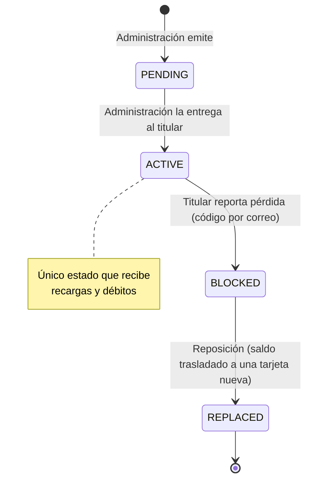

# Dominio: reglas de negocio, estados y glosario

Monedero es un **monedero electrónico prepago recargable de circuito cerrado**: el dinero solo se recarga y se gasta dentro del mismo comercio. No hay redes de pago (Visa/Mastercard), retiro de efectivo ni transferencias entre tarjetas.

## 1. Actores

| Rol | Identificador | Qué hace |
|---|---|---|
| Titular | `CARDHOLDER` | Se registra, consulta saldo e historial, muestra su tarjeta virtual, reporta pérdida, solicita reposición y cambia su PIN |
| Cajero | `CASHIER` | Desde un terminal autorizado: lee la tarjeta, cobra y recarga |
| Administrador | `ADMIN` | Emite y entrega tarjetas, ejecuta reposiciones, busca titulares y tarjetas, ve movimientos y conciliación, gestiona terminales |

Los roles se validan **en la API**; la app solo oculta lo que el rol no puede hacer.

## 2. Reglas de negocio (no negociables)

Son las mismas de `AGENTS.md`, sección 4. Aquí se explica el porqué.

| # | Regla | Por qué | Dónde se impone |
|---|---|---|---|
| 1 | Dinero en centavos, entero (`BIGINT` / `int`) | `double` no representa exactamente 0.10 y acumula errores de redondeo | core, API, base, guardia en `tool/check.dart` |
| 2 | Recarga: múltiplo de $5 y > 0 | Política del comercio para recargas en caja | core + API |
| 3 | Débito: > 0 y ≤ saldo; PIN si > $25 | Sin crédito ni sobregiro; el PIN protege compras grandes si roban la tarjeta | core + API + `CHECK` |
| 4 | Transacción con `SELECT … FOR UPDATE` | Evita que dos cajas gasten el mismo saldo a la vez | API |
| 5 | `Idempotency-Key` única | Un reintento por mala red no cobra dos veces | API + índice único |
| 6 | `CHECK (balance_cents >= 0)`; movimientos de solo inserción | Última barrera aunque la API tenga un error; historial inalterable | Base de datos |
| 7 | Saldo = suma de movimientos | Permite auditar y detectar cualquier descuadre | Vista de conciliación |
| 8 | Solo `ACTIVE` opera | Una tarjeta pendiente, bloqueada o repuesta no mueve dinero | API + base |
| 9 | Número de 16 dígitos con Luhn y prefijo | Detecta errores de digitación; prefijo identifica el emisor | core + API |
| 10 | Firma HMAC del número + UID | Impide fabricar tarjetas válidas conociendo solo el número | API (llave solo en servidor) |
| 11 | Pérdida con código por correo; reposición atómica | Bloqueo inmediato y saldo conservado sin riesgo de perderlo a medias | API + transacción |
| 12 | Sin operación sin conexión | No hay forma segura de evitar doble gasto sin el servidor | App + API |

### Montos de referencia

| Concepto | Valor | Configuración |
|---|---|---|
| Unidad de recarga | $5.00 (500 centavos) | fija |
| Botones de recarga en caja | $5, $10, $20 y "otro múltiplo de $5" | app |
| Débito que exige PIN | > $25.00 (2500 centavos) | `PIN_REQUIRED_ABOVE_CENTS` |
| Intentos de PIN | 3 | `MAX_PIN_ATTEMPTS` |
| Intentos de código por correo | 5 | `MAX_VERIFICATION_CODE_ATTEMPTS` |
| Moneda | USD, dos decimales (`$1,234.56`) | — |

## 3. Estados de la tarjeta

| Estado | Significado | ¿Recarga? | ¿Débito? |
|---|---|---|---|
| `PENDING` | Emitida, aún no entregada | No | No |
| `ACTIVE` | En uso | **Sí** | **Sí** |
| `BLOCKED` | Reportada como perdida | No | No |
| `REPLACED` | Sustituida por otra tarjeta; saldo trasladado | No | No |

Un titular puede tener varias tarjetas en su historial, pero en el prototipo solo una no repuesta a la vez.

## 4. Flujos principales

### Registro del titular
1. El titular ingresa nombre, correo y contraseña; define su PIN de 4 dígitos.
2. La API envía un código de verificación al correo (visible en Mailpit; en modo demo también en pantalla).
3. Al ingresar el código, el correo queda verificado y puede iniciar sesión con correo y contraseña.

### Emisión y entrega
1. Administración emite una tarjeta para un titular: se generan número (Luhn), UID y firma. Estado `PENDING`.
2. Al entregarla, administración la marca como entregada → `ACTIVE`. En la demo es un solo clic.

### Recarga y cobro
Ver el diagrama de secuencia en [architecture.md](architecture.md#3-flujo-de-una-operación-cobro-en-caja). La caja lee la tarjeta (QR que muestra la app del titular, lista demo o número), muestra titular y saldo, y cobra o recarga; el comprobante sale como ticket.

### Pago con código de caja
Cada caja muestra un **código de caja** de 6 dígitos. El titular, desde su app, toca "Pagar en caja", escribe el código y el monto (y su PIN si supera $25). Es el mismo cobro que hace la caja, con su tarjeta `ACTIVE`, y aparece al instante en los movimientos de esa caja.

### Pérdida y reposición
1. El titular reporta la pérdida en su app; la API envía un código por correo.
2. Con el código correcto, la tarjeta pasa a `BLOCKED` **de inmediato**.
3. El titular solicita la reposición; administración la ejecuta. En **una sola transacción**: se crea la tarjeta nueva `ACTIVE`, se traslada el saldo (movimientos `REPLACEMENT_OUT`/`REPLACEMENT_IN`), la anterior pasa a `REPLACED` y se registra la auditoría en `replacements`. Si algo falla, se revierte todo y el saldo sigue en la tarjeta bloqueada.

## 5. Tipos de movimiento

| Tipo | Signo | Origen |
|---|---|---|
| `TOP_UP` | + | Recarga en caja |
| `DEBIT` | − | Cobro en caja |
| `REPLACEMENT_OUT` | − | Saldo que sale de la tarjeta repuesta |
| `REPLACEMENT_IN` | + | Saldo que entra a la tarjeta nueva |

## 6. Glosario inglés–español

| Término en el código | Término en el informe | Definición |
|---|---|---|
| cardholder | titular | Persona dueña de la tarjeta |
| card | tarjeta | Medio de pago prepago con número único y saldo |
| balance | saldo | Dinero disponible en la tarjeta |
| `balance_cents` / `balanceCents` | saldo en centavos | Saldo como entero; $7.35 = 735 |
| amount | monto | Valor de una operación |
| top-up | recarga | Operación que aumenta el saldo |
| debit | débito / cobro | Operación que disminuye el saldo por una compra |
| transaction | movimiento | Registro inalterable de un cambio de saldo |
| ledger | libro de movimientos | Conjunto de todos los movimientos |
| reconciliation | conciliación | Comparación del saldo con la suma de movimientos |
| idempotency key | clave de idempotencia | UUID que identifica una operación para no aplicarla dos veces |
| replacement | reposición | Sustitución de una tarjeta perdida conservando el saldo |
| lost card report | reporte de pérdida | Aviso del titular que bloquea la tarjeta |
| terminal | terminal / punto de venta | Teléfono o navegador de caja autorizado |
| staff user | personal | Cajeros y administradores |
| cashier | cajero | Personal que cobra y recarga |
| PIN | PIN | Clave de 4 dígitos del titular |
| UID | UID | Identificador del chip (simulado con 7 bytes aleatorios) |
| signature | firma | HMAC-SHA256 del número + UID, truncado a 16 bytes |
| master key | llave maestra | Secreto del servidor para firmar tarjetas |
| card reader | lector de tarjetas | Componente de la app que obtiene número, UID y firma |
| demo mode | modo demo | Configuración que habilita cuentas y tarjetas de demostración, códigos en pantalla, buzón y reinicio |
| pay code | código de caja | 6 dígitos que identifican la caja para que el titular pague desde su app |
| terminal token | credencial de caja | Secreto del dispositivo de caja (`X-Terminal-Token`); se muestra una sola vez |
| refresh token | token de renovación | Secreto que permite pedir un JWT nuevo sin volver a escribir la contraseña; se rota en cada uso |
| rate limit | límite de solicitudes | Máximo de solicitudes por minuto y cliente (`RATE_LIMITED`) |
| demo inbox | buzón demo | Correos recientes del titular mostrados en la app (solo modo demo) |
| module | módulo | Parte de la app que administración enciende o apaga (asistente, registro, pago con código, QR, cambio de PIN); la API la bloquea con `MODULE_DISABLED` |
| assistant | asistente virtual | Chat del titular que responde dudas con sus datos reales; es un módulo |
| tunnel | túnel / link público | Dirección `https://….trycloudflare.com` temporal hacia la laptop para la exposición |
| PENDING / ACTIVE / BLOCKED / REPLACED | pendiente / activa / bloqueada / repuesta | Estados de la tarjeta |
